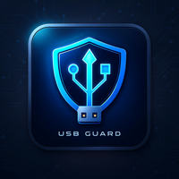

# USB Guard

**حماية الحاسبة والفلاشة من فايروسات الأوتورن والشورتكت**
 
USB flash drive protection for Windows — Autorun · Shortcut · gamez · Sality

### [⬇️ تحميل آخر إصدار — Download](https://github.com/tara44x-code/USBGuard/releases/latest/download/USBGuard.exe)

---

## ✨ المميزات

| | |
|---|---|
| 🛡️ **يعطّل الأوتورن** | يمنع تشغيل `autorun.inf` على كل الأقراص نهائياً |
| 🔗 **فايروس الشورتكت** | يحذف الاختصارات الخبيثة ويرجّع ملفاتك ومجلداتك |
| 📂 **الفلاشة تطلع فارغة** | يطلّع الملفات من المجلد المخفي الي سوّاه الفايروس |
| 🎮 **gamez وأمثاله** | يحذف فايروسات الفلاشة المعروفة وملفات exe المنتحلة أسماء المجلدات |
| 💿 **منع الكتابة / تسجيل CD** | يصلّح الإعدادات الي تخرّبها الفايروسات (الكتابة، CD، الملفات المخفية، مدير المهام) |
| 🔬 **فحص عميق** | يفحص الفلاشة بمحرك Windows Defender (يمسك Sality وغيره) |
| 💉 **تلقيح الفلاشة** | يحمي الفلاشة حتى ما يگدر الفايروس يسوي عليها autorun |
| 🖱️ **القائمة اليمنى** | كلك يمين على الفلاشة ← **فحص بـ USB Guard** قبل ما تفتحها |
| ⚡ **تلقائي** | يشتغل مع ويندوز ويفحص أي فلاشة أول ما توصلها |
| 🔄 **تحديث ذاتي** | يبلّغك بالتحديث الجديد ويحدّث نفسه **باختيارك** |
| 🌐 **عربي / English** | |

## 📥 التثبيت

1. نزّل **[USBGuard.exe](https://github.com/tara44x-code/USBGuard/releases/latest/download/USBGuard.exe)**
2. شغّله واضغط **نعم** على رسالة الصلاحية
3. خلص ✓ — البرنامج يثبّت نفسه ويشتغل بالخلفية

> لإلغاء التثبيت: من داخل البرنامج، أو من **الإعدادات ← التطبيقات**.

> **ويندوز 11:** خيار القائمة اليمنى يطلع تحت **Show more options** (أو Shift + كلك يمين).

## 🧰 نسخة السكربت (بدون تثبيت)

بمجلد [`script/`](script) تلگى نسخة PowerShell بسيطة من نفس الحماية.

## 🛠️ للمطورين

- C# / WinForms — .NET Framework 4.8 (موجود بكل ويندوز 10 و 11، ما يحتاج تنصيب شي)
- البناء تلقائي عن طريق GitHub Actions
- **لنشر تحديث:** غيّر `<Version>` بملف `src/USBGuard.csproj` واكتب التغييرات بـ `CHANGELOG.md` وارفع — يطلع Release جديد والبرنامج يبلّغ المستخدمين.

---

**المطور: [مهند سات لنك — Muhannad Sat Link](https://github.com/tara44x-code)**

